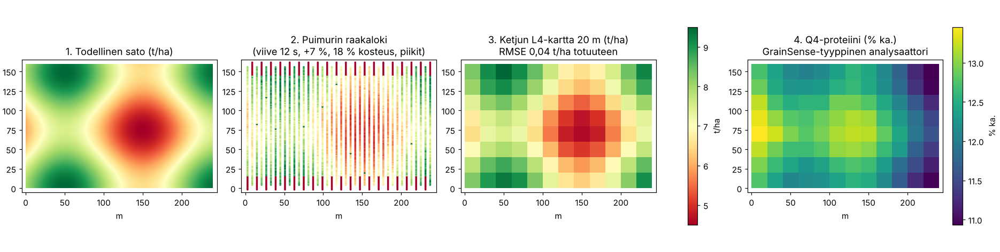

# Synteettinen testipelto

Kaikki suiten testit ajetaan keksityllä pellolla, jonka **oikea sato ja laatu
tunnetaan**. Näin jokainen korjaus voidaan tarkistaa: tuottaako ketju
puimurin virheellisestä datasta saman kartan kuin totuus. Koodi:
[`src/yieldsuite/synthetic.py`](../../src/yieldsuite/synthetic.py).



1. **Todellinen sato** – sileä kuvio, 4,5–9,5 t/ha.
2. **Puimurin raakaloki** sellaisenaan: viive näkyy kaistojen päissä (punaiset nollat, vilja ei ole vielä anturilla), piikit yksittäisinä pisteinä, taso 7 % liian korkea ja märkäpainossa.
3. **Ketjun L4-kartta 20 m ruudukossa** korjausten jälkeen: RMSE 0,04 t/ha totuuteen, kalibrointikerroin 0,934 (oikea 1/1,07 = 0,935), massa säilyy.
4. **Q4-proteiini** GrainSense-tyyppisestä analysaattorista laboratoriokalibroinnin jälkeen: virhe noin 0,06 %-yksikköä.

## Pelto ja kone

| Ominaisuus | Arvo |
|---|---|
| Koko ja sijainti | 240 × 160 m (3,84 ha), ETRS-TM35FIN, itä 400 000 m, pohjoinen 6 950 000 m (noin 62,65° N, 25,05° E; kuvitteellinen lohko) |
| Todellinen sato | 7 + 1,5 · sin(2πx / 200 m) + 1,0 · cos(2πy / 150 m) t/ha, 14 % kosteudessa |
| Puimuri | 6 m leikkuupöytä, 1,5 m/s, loki 1 Hz, 40 kaistaa vuorotellen pohjoiseen ja etelään, 20 s tauko päisteessä |
| Viive | 12 s leikkuupöydästä massavirta-anturille (tasainen viive) |
| GNSS-antenni | 3,2 m leikkuupöydän takana, RTK (laatu 4) |
| Mittarin virheet | taso +7 %, kohina 3 %, 15 mittauspiikkiä (×4) |
| Kosteus | 18 % ± 0,2 (vertailukosteus 14 %) |
| Vaakalaput | 6 kuormaa, yhteensä todellinen massa |
| Valinnaiset | kaistakohtaiset kertoimet (raidat, `pass_gain_sd`), satunnaissiemen (`seed`) |

## Laatu, kuvat ja monivuotinen data

| Lisä | Malli |
|---|---|
| Proteiini (% ka.) | 12,5 − 0,4 · (sato − 7) + 0,8 · cos(πx / 240 m): laimenemisvaikutus ja itä–länsi-trendi |
| Analysaattori | mittaus 5 s välein, 12 s viive, harha +0,5 %-yksikköä, kohina 0,15; 4 laboratorionäytettä (60 s ikkunat) |
| Sentinel-2-piirteet | NDVI = 0,2 + 0,06 · sato + kohina, 3 päivää; red edge -indeksi siitä johdettuna |
| Monivuotinen data (lohkojako) | erillinen 40 × 30 solun pelto: 3 lohkoa (80 / 100 / 120 %), epävakaa alue (±25 % vuosittain), vuosikohtainen taso ja kuvio |

## Mitä pellolla on todennettu

| Tarkistus | Tulos |
|---|---|
| L1–L4-ketju | RMSE 0,04 t/ha, bias +0,006 t/ha, massa säilyy |
| Viiveen arvio datasta | 11,6–12,4 s kuudella siemenellä (oikea 12 s) |
| Väärä viive | kartta huononee; kuvan siirtymätarkistus ehdottaa +11 s |
| Raidat 10 % / 5 % | L4 0,485 → L5 0,162 / 0,172 → 0,132 t/ha |
| Tuonti 7 eri muodosta | suomalainen CSV, bu/ac-satopisteet, GeoPackage, Excel, ISOXML, Ag Leader samasta pellosta |
| Proteiini | analysaattorin harha arvioitu −0,51 (oikea +0,5), kartan virhe 0,06 %-yksikköä |
| Lohkojako | 3 lohkoa löytyy, vastaavuus > 0,95 viidellä vuodella |

## Kokeile itse

```bash
yieldsuite demo demo/                      # loki, vaakalaput ja asetukset
yieldsuite run demo/field.yaml --to L4
yieldsuite delay demo/field.yaml           # viivekäyrä
yieldsuite store-demo ~/tiladata           # sama pelto MCP-datavarastoon
python examples/make_synthetic_figure.py kuva.png
```

Rajoitus: synteettinen pelto on helpompi kuin oikea. Viive on vakio, sato
on sileä, eikä mukana ole lakoa, kääntymisiä kesken kaistan, useaa konetta
tai GNSS-katkoja. Oikean datan testaus on siksi seuraava välttämätön askel.
